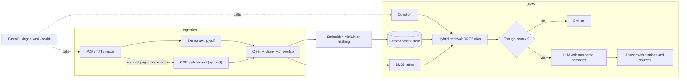

# RAG Document Assistant

[](https://github.com/Beru47/rag-document-assistant/actions/workflows/ci.yml)

Ask questions about your PDFs, text files and scanned images and get **answers with source citations**, or an explicit **refusal** when the documents do not contain the answer. A compact reference implementation of a retrieval-augmented generation pipeline: OCR and text ingestion, chunking, embeddings, a vector database, hybrid retrieval with LangChain, a FastAPI service, and an evaluation harness that runs in CI without any API key.

> Personal reference project. It is not a production system and makes no claims about production use. The evaluation corpus is small and synthetic; read the numbers below as a regression harness, not a benchmark.

## Architecture



## Design decisions

- **Chunking: 400 characters, 80 overlap** (`RecursiveCharacterTextSplitter`, paragraph then sentence boundaries). Small chunks keep each passage on one fact and fit MiniLM's input window; the overlap prevents a fact from being cut at a boundary. Both are env-configurable.
- **Hybrid retrieval.** Dense vectors catch paraphrases; BM25 catches exact tokens such as `AES-256` or `Idempotency-Key` that embeddings blur. The two rankings are merged with **reciprocal rank fusion** (k=60), which needs no score normalisation. A cross-encoder reranker would be the next step; fusion was kept as the only ranking stage to stay simple.
- **Citations.** The LLM sees numbered passages (`[1] (source: file) text`) and must cite them. The API returns only the passages actually cited, with file, page and text, so every claim can be checked.
- **Refusal in two layers.** (1) If no retrieved passage covers at least half of the question's content words, the LLM is never called. (2) The prompt tells the model to reply `INSUFFICIENT_CONTEXT` when the passages do not answer; that is mapped to a refusal. The coverage gate is deliberately crude and lexical, and it trades some false refusals for fewer made-up answers (see results).
- **Pluggable parts.** Embeddings sit behind LangChain's `Embeddings` interface (`minilm` by default, a deterministic `hashing` embedder for tests/CI). The LLM is chosen with `RAG_LLM_PROVIDER`: `openai` (any OpenAI-compatible server via `OPENAI_BASE_URL`), `anthropic`, or `fake`.
- **OCR is optional.** Without the `ocr` extra or the tesseract binary, image files and scanned PDF pages are reported under `skipped` instead of failing the request.

## Evaluation

`make eval` indexes `data/corpus` (8 short synthetic policy/API documents, 17 chunks) and runs `data/qa.json` (24 answerable + 4 unanswerable questions). Output of a real run, hashing embedder and the extractive stand-in LLM:

```
retrieval (answerable questions)
mode     hit@1   hit@3   hit@5   mrr
vector   0.875  0.917  0.917  0.896
bm25     0.917  0.958  0.958  0.938
hybrid   0.917  0.958  0.958  0.938

generation (hybrid, k=4)
answered answerable questions : 21/24
faithfulness (citation overlap): 1.000
correct refusals (unanswerable): 4/4
```

How to read it honestly:

- **Hit@k / MRR**: a retrieved chunk counts only if it comes from the gold file *and* contains the gold evidence phrase.
- **Faithfulness** is a simple check: the answer has at least one valid citation and at least 60% of its content words appear in the cited chunks. It does not judge semantic correctness.
- The CI run uses an **extractive stand-in** (it returns the best-matching context sentence with its citation), so the 1.000 faithfulness mostly validates the citation and checking plumbing, not a real LLM. The 3 answerable questions that went unanswered are false refusals from the coverage gate. Run `python -m rag_assistant.eval --llm openai` (or `anthropic`) with keys set to measure a real model, and `--embeddings minilm` for the real embedding model; those numbers are not reported here because they were not run.
- Hashing is a lexical embedder, so on this corpus vector and BM25 behave similarly and hybrid cannot show a gain. A larger, paraphrase-heavy corpus with MiniLM is needed to show the benefit of fusion.

## Run it

```bash
python -m venv .venv && source .venv/bin/activate
pip install -e ".[dev,minilm,ocr]"        # add ,openai or ,anthropic for a real LLM
cp .env.example .env                       # optional

make test      # pytest, no keys or downloads
make eval      # prints the table above
make run       # http://localhost:8000/docs
```

OCR needs the tesseract binary (`apt install tesseract-ocr`, or the Windows installer). Without it everything else still works.

```bash
curl -F "files=@report.pdf" -F "files=@notes.txt" localhost:8000/ingest
curl -X POST localhost:8000/ask -H 'content-type: application/json' \
     -d '{"question": "How long is the probation period?"}'
# {"answer": "... [1]", "refused": false, "sources": [{"ref": 1, "source": "onboarding.md", "page": null, "text": "..."}]}
```

Docker: `docker compose up --build` (the compose file also defines an optional `pgvector` service for future experiments; it is not used yet).

## Structure

```
src/rag_assistant/
  ingest.py      PDF/text/image loading, OCR fallback, cleaning, chunking
  embeddings.py  MiniLM (sentence-transformers) and hashing embedders
  store.py       Chroma + BM25, reciprocal rank fusion
  qa.py          prompt, citations, refusal gates
  llm.py         OpenAI-compatible / Anthropic / extractive stand-in
  eval.py        hit@k, MRR, faithfulness, refusal accuracy
  api.py         FastAPI app
data/            synthetic corpus and Q/A set
tests/           chunking, ingestion, retrieval, answering, API (no keys needed)
```

## Roadmap

- Cross-encoder reranking on top of the fused candidates.
- Evaluate with MiniLM and a real LLM on a larger, paraphrase-heavy corpus.
- pgvector store implementation; incremental BM25 updates instead of full rebuilds.
- Streaming answers and per-document deletion.
